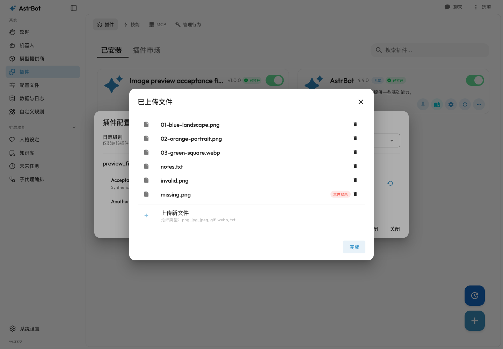
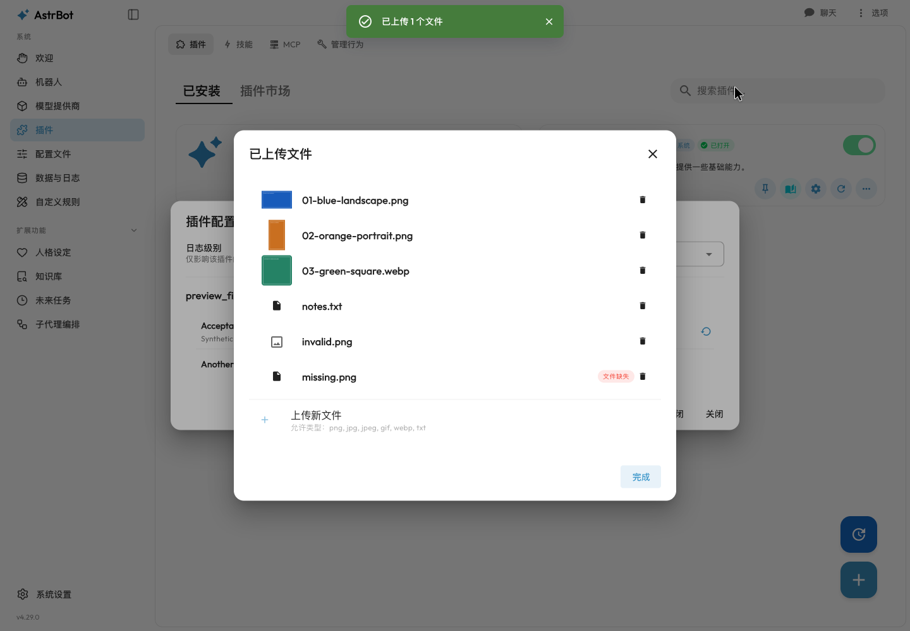
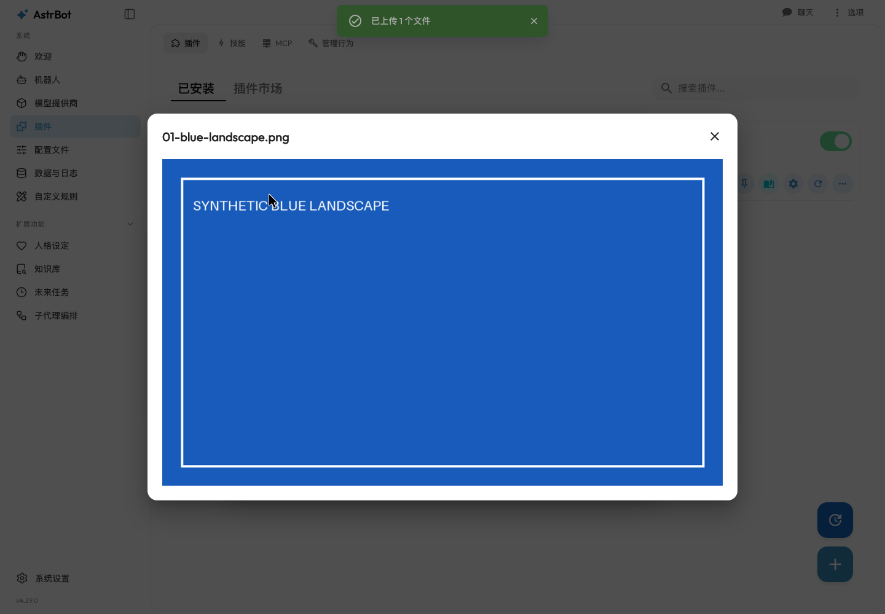
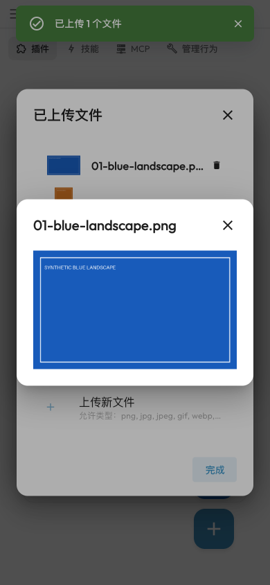

# AstrBot #10595: real dashboard acceptance evidence

Issue: https://github.com/AstrBotDevs/AstrBot/issues/10595

Product base: `de898afe7588e1f153beec06e24f03f6ddeae2e4`
Tested product commit: `cd8705fcd97d17c1479504ed2c99d920d566f9ff`

The images are unedited browser screenshots of the actual AstrBot dashboard.
The recording is actual browser interaction, not a mockup or a generated UI.
The sample pictures and plugin are deliberately synthetic acceptance fixtures.
No paid model, messaging platform, real plugin account, or user data is involved.

## Before and after

| Unmodified base | Product change |
| --- | --- |
|  |  |





[Short interaction recording](preview-demo.webm)

The before screenshot uses the unmodified base's running backend and production
dashboard build. The after screenshots and recording use the changed backend and
production build, the same isolated data root, and the same sample files.

## Verification

- Unmodified baseline: **4001 passed, 4 skipped**.
- Final full Python suite: **4032 passed, 4 skipped**, using
  `bash scripts/run_pytests_ci.sh ./tests`.
- Added **31 API regression cases** in the existing dashboard test module:
  JWT and plugin-scope authentication; incorrect scope and anonymous rejection;
  file-field/path isolation; symlink files, directories, field-directory aliases
  and loops; missing/corrupt/unsupported images; byte/pixel/decompression limits;
  supported raster formats; EXIF orientation and metadata removal; first
  animation frame; original-file preservation.
- Existing dashboard Node tests: **66 passed**.
- Python full-repository Ruff format/check: passed.
- Actual commit hooks on the changed files: passed, without skipping hooks.
- Dashboard API generation, locale-key validation, typecheck and production
  build: passed. Final build uses Node **24.13.0**, pnpm **10.28.2**, matching CI.
- Chinese/English docs and generated scope references updated; VitePress
  production build: passed.
- **21 real-browser assertions passed**, including same-name overwrite refresh,
  keyboard operation, missing/corrupt/non-image behavior, unconfigured-file
  preview/add/delete, mobile bounds, field isolation, repeat open/close,
  cancellation during delayed real HTTP requests, no late object URLs and no
  credentials in image URLs.
- Lifecycle instrumentation in the final browser run:
  **25 object URLs created, 25 revoked, 0 left live**.

The repository-wide `pre-commit run --all-files` also rewrites two unrelated
baseline files (`log_service.py` and `test_lark_private_chat_fallback.py`) through
pyupgrade. Those incidental rewrites were reverted and are not in the product PR.
Full Ruff checks and the normal changed-file commit hooks pass.

The four skipped Python tests are also skipped on the unmodified baseline.
This is not live IM-platform/model validation or a full deployment security audit.
The deliberately invalid PNG returns the expected 415 and a fallback icon;
the existing dashboard emits Vuetify list warnings as on the baseline.

## Reproducing the visual fixture

Use a disposable checkout/data root; never reuse these fixture credentials in a
real deployment. The `fixture/` directory contains the three tiny plugin files
and a preparation script. Copy the plugin files to
`$ASTRBOT_ROOT/data/plugins/astrbot_plugin_preview_fixture/`. From an AstrBot
development environment, run the preparation script with `ASTRBOT_ROOT` pointing
to that disposable root, build the dashboard, then start:

```sh
ASTRBOT_ROOT=/absolute/disposable/root \
DASHBOARD_HOST=127.0.0.1 DASHBOARD_PORT=6187 \
uv run main.py --webui-dir /absolute/path/to/dashboard/dist
```

The preparation script creates loopback-only dashboard configuration and synthetic
files, and overwrites configuration only inside the explicitly supplied root.
Open **Plugins → Installed → Image preview acceptance fixture → gear icon →
Manage Files**. The script contains local-only test login credentials.

This evidence branch is separate from the feature branch, so the screenshots,
recording, fixture plugin, and this report are not part of the product PR diff.

Disclosure: investigation, implementation, tests, self-review and this evidence
were produced with OpenAI Codex assistance. No independent human review,
maintainer approval, or successful upstream CI is implied.
