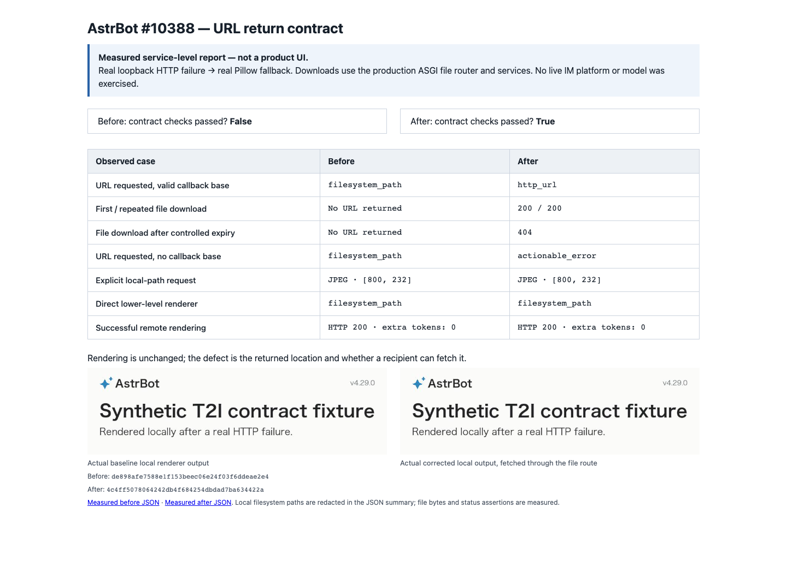

# AstrBot #10388: measured T2I return-contract evidence

Issue: https://github.com/AstrBotDevs/AstrBot/issues/10388

Base: `de898afe7588e1f153beec06e24f03f6ddeae2e4`
Corrected product: `4c4ff5078064242db4f684254dbdad7ba634422a`



This screenshot is a clearly labelled **service-level report generated from the
measured JSON**, not a screenshot of a new dashboard feature. Both pictures are
real output of AstrBot's local Pillow renderer. There is no product UI change,
so the primary evidence is the executable reproduction, observed result kinds,
actual file-route responses and image bytes.

## Actual execution boundary

1. Start an actual loopback HTTP renderer fixture. URL-mode requests get HTTP
   503; path-mode requests get a real connection close.
2. Call the selected checkout's real `Star.text_to_image()` and real
   `HtmlRenderer` / local render strategy.
3. For a corrected local URL, make two requests through the production ASGI
   token-file router and real `FileService` / `FileTokenService`: **200 / 200**,
   same bytes as the generated JPEG.
4. Move the stored expiry timestamp into the past and request again: **404**.
   This verifies expiry handling; it is **not** a five-minute wall-clock soak.
5. Also exercise missing callback configuration, explicit path mode, the direct
   lower-level renderer, and a successful synthetic remote image response.

The renderer HTTP is real network I/O on `127.0.0.1`; file-download integration
is in-process ASGI. No live model, IM platform, external renderer or complete
deployed dashboard was exercised. The context configuration and remote service
are isolated synthetic fixtures. Local filesystem paths are redacted in the
JSON summary; temporary file capability URLs are synthetic and expired.

## Observations

The [before JSON](before.json) has failed URL-contract checks: a caller asking
for a URL receives a local path even with a callback base, and without a base
does not receive the required actionable error.

The [after JSON](after.json) has all **six measured contract/control checks
passing**: a proper URL, repeated downloads and controlled expiry, actionable
missing-base error, unchanged local-path/lower-level-renderer behavior, and
unchanged remote success with no extra file tokens.

Each JSON records the imported source commit and source-file SHA-256. The
reproducer asserts that the imported production module belongs to the requested
checkout, avoiding accidental use of another editable installation.

## Tests and review

- Identical base `de898af`: full Python baseline **4001 passed / 4 skipped**,
  measured earlier in this contribution batch on the same base.
- Focused unmodified regression: **14 failed / 3 controls passed** before the
  fix. The actual HTTP failure was 503, not a fixture setup/import error.
- Final full Python suite: **4024 passed / 4 original skips**.
- **23 added cases** in existing test modules. Covers callback validation,
  reverse-proxy path/trailing slash, configuration lookup, reusable tokens,
  missing files, no registration on remote/path requests, actual HTTP failure,
  actual local rendering, real production ASGI downloads and controlled expiry.
- Full repository Ruff check and format check: passed.
- Normal changed-file pre-commit and prepare-commit hooks: passed without bypass.
- Chinese/English plugin documentation and legacy Chinese guide updated;
  VitePress production build: passed.
- Product diff self-reviewed: six files, no renderer rewrite, new HTTP route,
  dependency, configuration switch, screenshot or fixture in the product diff.

Compatibility is explicit: a plugin that relied on the undocumented local-path
result from `return_url=True` must configure a reachable HTTP(S) callback base or
request `return_url=False`. Local fallback URLs use reusable tokens with the
existing service lifetime (five minutes by default), not permanent public assets.
Automatic core T2I still uses its existing lower-level URL/path handling.

The existing repository-wide pyupgrade baseline rewrites reported for #10596
are unrelated and excluded here as well; normal commit hooks pass.

## Reproduce

Use two disposable checkouts at the recorded commits and a development Python
environment (`uv sync --group dev`). From that environment:

```sh
python reproduce.py --source /path/to/before-checkout --output /tmp/t2i-before
python reproduce.py --source /path/to/after-checkout --output /tmp/t2i-after
```

The script creates test data and configuration only below the supplied output
directory. Its dashboard credential is a fixed, public, fixture-only value;
never reuse the generated test configuration for a real deployment.

Evidence lives on a separate fork branch and does not ship with the product PR.
Disclosure: implementation, tests, self-review and this evidence are
OpenAI-Codex-assisted. No independent human approval or upstream CI success
is implied.
