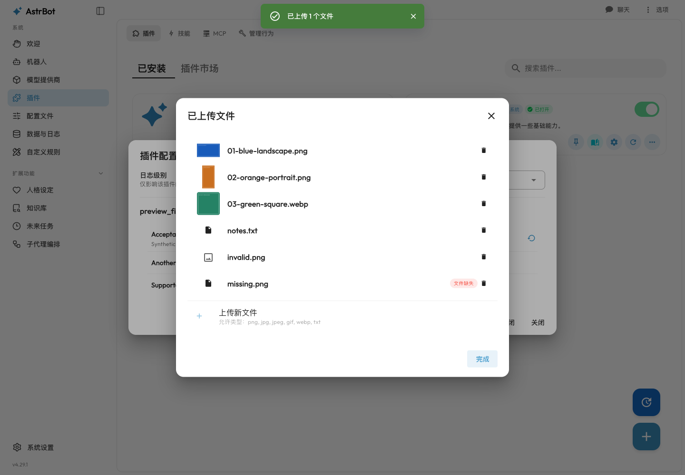
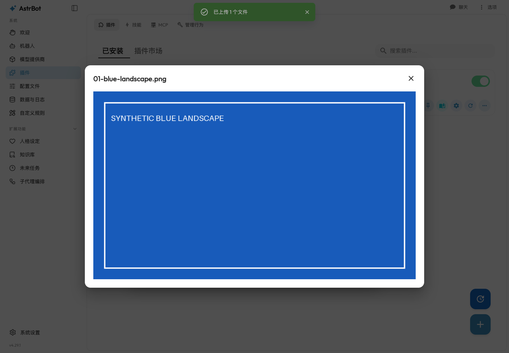
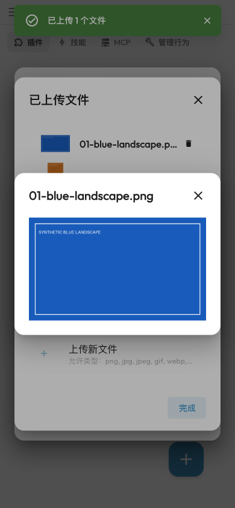
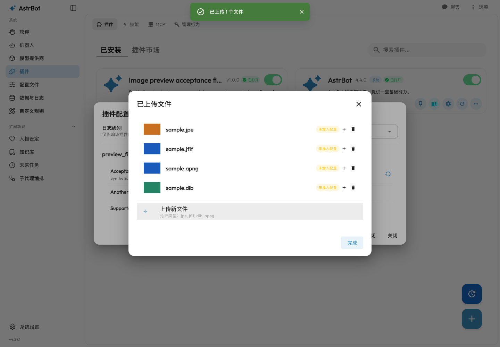

# Image preview: master-sync acceptance, 2026-10-18

PR: https://github.com/AstrBotDevs/AstrBot/pull/10596

Product head: `ae728172062566bd251be143a40d9ecd79ffbdb5`

Synchronized master: `8774e53ff46195b9c7031165553b786fa847e612`

The generated SDK import conflict is resolved by regenerating from the merged
OpenAPI document. Both image-preview and upstream trace endpoints are retained.
The original 20 feature files remain in scope, plus one restart-test adjustment.
There are no production restart changes, dependency additions, workflow changes,
reports, media, or fixture credentials in the product PR.

## Current screenshots and recording

These are unedited captures of the actual backend and production dashboard, using
a newly recreated isolated synthetic plugin and image fixture. Desktop screenshots
are 1440 × 1000; the mobile screenshot is 390 × 844. No live model or IM calls were
made. Successful image requests use the real authenticated endpoint.

[10.6-second actual interaction recording](preview-verified.webm)

The original feature and review before/after comparisons remain in the parent
directory, explicitly tied to their original revisions. This supplement validates
the synchronized version; it does not relabel old captures as current ones.

## Verification

- Full Python suite: **4702 passed, 11 skipped**, using
  `bash scripts/run_pytests_ci.sh ./tests -rs -o faulthandler_timeout=90`.
- Focused dashboard/auth/OpenAPI/storage checks: **345 passed**.
- Lifecycle checks after correcting the restart fixture: **26 passed**.
- Dashboard Node tests: **78 passed**.
- Full Ruff format/check, normal commit hooks without bypass, dashboard typecheck,
  four-locale key validation, production dashboard build, API regeneration and
  regeneration consistency, public OpenAPI/scope generation, and docs build passed.
- Frontend tools match CI: **Node 24.13.0 / pnpm 10.28.2**.
- **31 real-browser assertions passed**, with **29 object URLs created, 29 revoked,
  and zero remaining**. These cover actual supported aliases, keyboard/mobile
  behavior, same-name overwrite, add/delete, field isolation, and URL lifecycle.
  Only the 500/415/network/wrong-MIME and delayed-request cancellation cases use
  controlled fault injection.

The 11 skips consist of seven Windows-only cases, three Linux/bubblewrap cases,
and one optional `edge_tts` import. This is native macOS validation, not a claim
that Windows/Linux tests or hosted CI ran. Existing deprecation/runtime warnings,
the loopback welcome-page announcement CORS error, and existing Vuetify warnings
are not represented as fixed by this change.

## Why one lifecycle test changed

An initial complete run hung in the pre-existing restart test. A fresh, unmodified
checkout of master `8774e53` reproduces the same hang in that single test; a
30-second diagnostic deadline interrupts it rather than treating it as a pass.

Master introduced `await asyncio.to_thread(close_trace_store)`, while the old test
mocks `threading.Thread` globally. That also intercepts the default executor's
worker creation, so its future cannot run. The test now mocks `asyncio.to_thread`
and explicitly verifies that it is awaited with `close_trace_store`, while
preserving the manager-termination and restart-thread assertions. Production
restart behavior is unchanged. The complete suite was then rerun successfully,
without deselection or a new skip.

## Source provenance and limits

Production build and the 31 browser checks used tree
`918b0edb3389617eb44cdb89e514a446bc81eeda`. Final head has tree
`421e401bc16e639e5a73851ae60f33282ed11e51`; the only difference is
`tests/unit/test_core_lifecycle.py`. All backend and dashboard source blobs are
identical. The screenshots and recording were captured after that test adjustment.

The synchronized branch is also conflict-free against the later master
`e5e21b71aec5642f110eb115eb8e9a0d8028b7e5`; the full local test/build results
above are for the stated product head, not an untested hypothetical merge.

These results are local acceptance evidence and self-review, not independent
human approval, a production security audit, or successful hosted CI. The PR's
GitHub Actions still require maintainer authorization. No CLA, review, workflow,
or owner gate was bypassed.

Disclosure: implementation, tests, self-review, and evidence were produced with
OpenAI Codex assistance.
